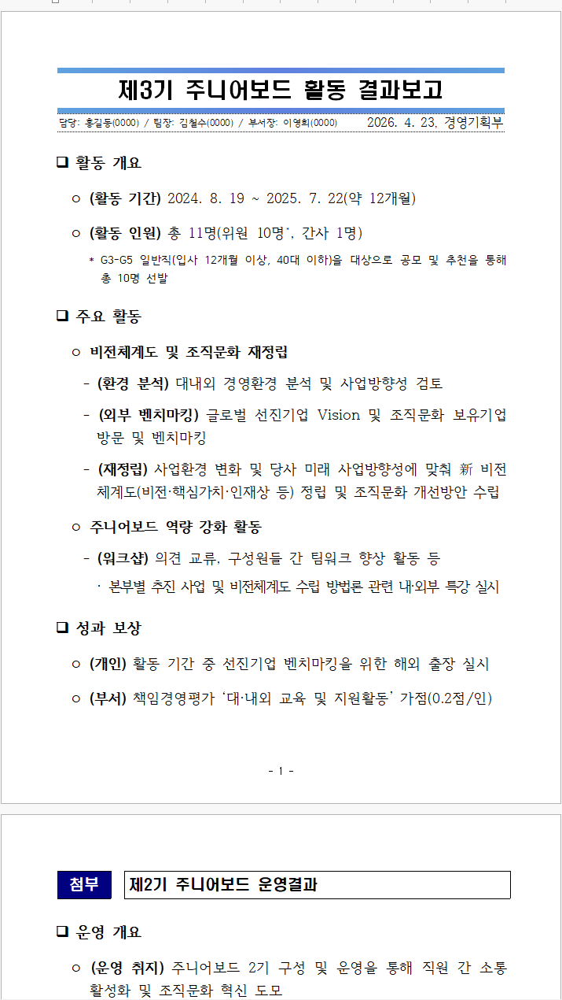
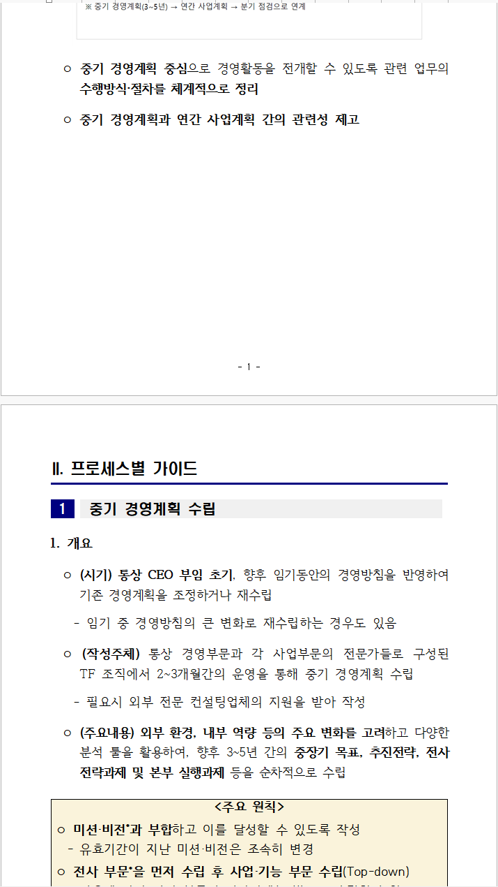

# 코스콤 한글 보고서 스킬 (koscom-hwp-report)

메모·회의록·초안처럼 **내용만 주면** Claude가 코스콤 보고용 표준 양식의 한글(`.hwp`) 파일을 만들어 주는 Claude Code 스킬입니다.

- **요약보고:** 제목 박스(결재라인·날짜·부서), □ 대제목, ㅇ / - / · 단계, 표, 첨부·참고
- **상세보고:** 표지, 목차(쪽번호 자동), I. 장 / [1] 절 박스, 그림, 별첨

글꼴·간격·표 서식은 원본 템플릿에서 뽑은 블록을 그대로 복제해 채웁니다. 그래서 손으로 서식을 맞출 필요가 없습니다.

| 요약보고 예시 | 상세보고 예시 |
|---|---|
|  |  |

*예시는 `references/examples/`의 샘플을 렌더링해 한컴 뷰어로 캡처한 화면입니다. 결재라인은 가명입니다.*

---

## 이렇게 요청하면 됩니다

Claude Code에 평소 말하듯 쓰면 됩니다. "코스콤", "hwp"라고 하지 않아도 사내 보고 문서를 만드는 요청이면 스킬이 동작합니다.

```text
팀장님께 올릴 보고서 하나 한글 파일로 만들어줘. 우리 회사 요약보고 양식으로.
제목: 11월 전사 정보보호 교육 결과
작성: 정보보호부 / 담당 홍길동(1234), 팀장 김철수(2345), 부서장 이영희(3456) / 2026년 11월 28일
- 교육 기간은 11월 3일부터 21일까지 3주
- 대상 412명, 이수 397명(96.4%), 작년 91.2%보다 5.2%p 상승
- 미이수 15명은 12월 12일까지 추가 교육
결과 파일은 정보보호교육_결과보고.hwp 로 저장해줘.
```

```text
본부장 보고용으로 "생성형 AI 활용 업무혁신 추진계획"을 표지랑 목차 있는 상세보고서로 만들어줘.
디지털혁신본부 / AI전략팀, 담당 한지수(7201) / 팀장 오세훈(7200) / 부장 윤가람(7000), 2026.11
I. 추진 배경 … II. 추진 현황 … III. 추진 과제 … IV. 기대 효과 …
단계별 일정은 표로 정리해줘: 과제 / 1분기 / 2분기 / 3분기 / 4분기
```

Claude는 다음 순서로 일합니다.

1. 내용을 코스콤 개조식으로 다듬습니다. 한 항목 3줄 이내, 명사형 종결, `(라벨)` 형식입니다.
2. 다듬은 내용을 `report.json`으로 정리합니다.
3. 렌더러로 `.hwp`를 만들고 경고를 확인합니다.
4. 한컴 뷰어로 열어 화면을 캡처하고 줄 걸침·쪽 넘침·목차 쪽번호를 확인합니다.
5. 파일 경로, 보고서 구성, 남은 확인 사항을 알려 줍니다.

**팁**
- **결재라인:** 정보를 주지 않으면 지어내지 않고 `○○○(내선)`으로 비워 둡니다.
- **보고 유형:** 요약보고인지 상세보고인지 말하지 않으면 분량을 보고 정합니다.
- **고쳐 다시 만들기:** 결과 폴더에 남는 `report.json`을 고쳐 "이 JSON으로 다시 만들어줘"라고 하면 됩니다.
- **표:** 칸 병합도 됩니다(예: "수도권 두 줄은 권역 칸 하나로 합쳐줘"). 참고 점선 박스 안에 표를 넣어도 박스 폭에 맞춰 줄어듭니다.

---

## 설치

### 1. 준비물

| 항목 | 필요 여부 | 확인 방법 |
|---|---|---|
| Windows 10/11 | 필수 | |
| [Claude Code](https://claude.com/claude-code) (CLI 또는 Claude 데스크톱 앱의 Code 탭) | 필수 | |
| Java 8 이상 (JRE로 충분) | 필수 | PowerShell에서 `java -version` |
| 한컴오피스 뷰어 또는 한글 | 권장 | 없으면 결과 화면 확인만 건너뜁니다 |
| Git 또는 GitHub CLI | 설치할 때만 | `git --version` / `gh --version` |

> 이 스킬은 내 PC에서 PowerShell·Java·한컴 뷰어를 실행합니다. 그래서 claude.ai 웹 채팅에 올려서는 동작하지 않습니다. **Windows의 Claude Code**에서 사용하세요.

### 2. 저장소 접근 권한

비공개 저장소입니다. 저장소 관리자(humanist96)에게 GitHub 계정을 알려 주고 **Collaborator 초대**를 받은 뒤 진행하세요.

### 3. 스킬 폴더에 내려받기

Claude Code는 `%USERPROFILE%\.claude\skills\` 아래 폴더를 개인 스킬로 읽습니다. 폴더 이름은 반드시 `koscom-hwp-report`로 하세요.

GitHub CLI를 쓰는 경우:

```powershell
gh repo clone humanist96/koscom_hangul_skill "$env:USERPROFILE\.claude\skills\koscom-hwp-report"
```

Git을 쓰는 경우:

```powershell
git clone https://github.com/humanist96/koscom_hangul_skill.git "$env:USERPROFILE\.claude\skills\koscom-hwp-report"
```

팀 프로젝트 저장소에서만 쓰려면 그 프로젝트의 `.claude\skills\koscom-hwp-report\`에 넣어도 됩니다.

### 4. 확인

Claude Code를 새로 열고 다음처럼 물어보세요.

```text
코스콤 한글 보고서 스킬 있어?
```

스킬이 보이면 설치된 것입니다. 렌더러만 따로 시험하려면 다음을 실행합니다. 마지막 줄이 `OK …`이면 정상입니다.

```powershell
cd "$env:USERPROFILE\.claude\skills\koscom-hwp-report"
.\scripts\render.ps1 -Json references\examples\summary_sample.json -Out "$env:TEMP\test_summary.hwp"
```

### 5. 업데이트

```powershell
git -C "$env:USERPROFILE\.claude\skills\koscom-hwp-report" pull
```

---

## 자주 묻는 문제

| 증상 | 원인과 해결 |
|---|---|
| `java`를 찾을 수 없음 | Java를 설치하고 PowerShell을 새로 여세요(`java -version`으로 확인) |
| 렌더러가 `templates\summary_base.hwp`를 못 찾음 | 사내 개인정보 보호 도구가 템플릿을 `*.hwp.pia`로 암호화했을 수 있습니다. 암호를 해제하거나, 보안 담당 안내에 따라 저장소에서 다시 받으세요 |
| 만든 `.hwp`가 `.pia`로 바뀜 | 실명·내선번호가 들어간 문서는 보호 도구가 암호화할 수 있습니다. 사내 절차대로 해제해 사용하세요 |
| 결과 확인 단계에서 뷰어 창이 안 보이거나 시간 초과 | Claude Code 샌드박스 안에서는 뷰어 창이 보이지 않습니다. Claude가 권한을 물으면 허용하세요. 느린 PC는 뷰어를 한 번 직접 열어 둔 뒤 다시 시도하세요 |
| `WARN …` 줄이 나옴 | 서식 점검 결과입니다(3줄 초과, 한두 글자 걸침, 쪽 넘침, 칸 넘침 등). 보통 Claude가 문장을 다듬어 다시 렌더링합니다. 경고 목록은 `SKILL.md` 5단계에 있습니다 |
| 줄바꿈·쪽이 한글 정식판과 조금 다름 | 줄·쪽 계산은 한컴 뷰어 화면으로 맞췄습니다. 쪽 경계에 아슬아슬한 내용은 열어서 확인하세요 |

**지원하지 않는 것:**
- 글자 색, 형광펜, 밑줄 같은 임의 서식
- 차트 자동 생성. 이미지로 만들어 그림으로 넣는 것은 됩니다
- 기존 `.hwp` 고쳐 쓰기
- 쪽번호 이외의 머리말·꼬리말

---

## 폴더 구성

```text
koscom-hwp-report/
├── SKILL.md                 # Claude가 읽는 작업 지침(트리거·작업 순서·경고 대응)
├── references/
│   ├── writing_guide.md     # 코스콤 개조식 작성 원칙
│   ├── report_schema.md     # report.json 형식(표·상세보고·그림 포함)
│   ├── style_map.md         # 블록별 글꼴·간격·구현 규칙
│   └── examples/            # 요약·상세 예시 JSON(가명)과 그림
├── scripts/
│   ├── render.ps1           # report.json → .hwp
│   ├── preview.ps1          # 한컴 뷰어로 열림 확인 + 뷰어 창만 캡처
│   ├── build.ps1            # src/ → koscom-hwp.jar 재빌드(JDK 필요)
│   └── koscom-hwp.jar       # 렌더러
├── templates/               # 요약·상세 기본 템플릿과 블록 카탈로그
├── src/                     # 렌더러 소스(Java 8 호환)
├── lib/                     # hwplib 1.1.9 (Apache-2.0)
├── evals/                   # 평가 과제 3개(claude plugin eval 형식)
└── docs/                    # README 그림
```

---

## 품질 평가

같은 요청 3개를 스킬을 쓴 경우와 쓰지 않은 경우로 나눠 비교했습니다. 2026년 10월, 2차 반복 결과입니다.

| 과제 | 스킬 사용 | 스킬 미사용 |
|---|---|---|
| 회의 메모 → 요약보고 | 10/10 | 8/10 |
| 실적표(칸 병합) + 참고 → 요약보고 | 12/12 | 10/12 |
| 표지·목차 상세보고 | 11/11 | 8/11 |
| **평균 통과율 / 평균 소요 시간** | **100% / 약 4분** | **79% / 약 12분** |

스킬 없이도 Claude가 `.hwp`를 만들 수는 있습니다. 하지만 본문 글꼴, 템플릿 블록, 참고 라벨 박스, 목차 쪽번호 같은 **코스콤 서식 준수**에서 차이가 났습니다.

---

## 유지보수

- **렌더러 수정:** `src/`를 고친 뒤 `.\scripts\build.ps1`을 실행합니다. JDK(javac)가 필요합니다.
- **템플릿 재생성:** `TemplateBuilder`로 원본 서식(요약·상세 Template.hwp)에서 다시 만듭니다. 명령은 `scripts\build.ps1` 머리 주석에 있습니다.
- **줄·쪽 계산:** `src/Layout.java`(글자 폭·줄 경계)와 쪽 높이 모델은 한컴 뷰어 캡처로 잰 값입니다. 바꾸려면 다시 측정하세요.
- **평가 과제:** `evals/`에 있습니다. 새 기능을 넣으면 과제를 추가해 확인하는 것을 권장합니다.

문의와 개선 제안은 저장소 Issues 또는 관리자에게 보내 주세요.

## 라이선스와 주의

- `lib/hwplib-1.1.9.jar`는 [hwplib](https://github.com/neolord0/hwplib)(Apache License 2.0)입니다. 자세한 내용은 `lib/NOTICE.md`를 보세요.
- 템플릿과 서식은 코스콤 사내 보고 양식입니다. **사내 업무 용도로만** 쓰고 외부로 배포하지 마세요.
- 예시와 평가 과제의 이름·내선번호는 모두 가명입니다.
