# 문서 유형 템플릿 (프리셋)

코스콤 요약보고·상세보고 양식 위에 **문서 종류별 구성·표·작성 규칙**을 정해 둔 템플릿 13종이다. 서식(글꼴·간격·박스)은 렌더러가 base 템플릿에서 그대로 가져오고, 프리셋은 "무엇을 어떤 순서로 쓰나"만 정한다. 그래서 렌더러를 고치지 않고 템플릿을 늘릴 수 있다.

예시의 이름·부서·고객사·수치는 모두 가상이다.

## 목록

| | id | 이름 | 형식 | 구성 |
|---|---|---|---|---|
| 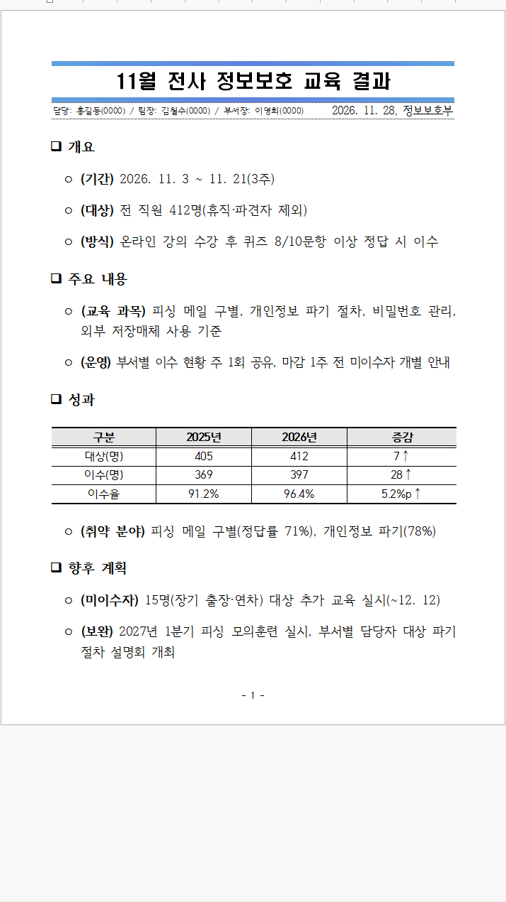 | `result-report` | 결과보고 | 요약 | 개요 → 주요 내용 → 성과(표) → 향후 계획 |
| 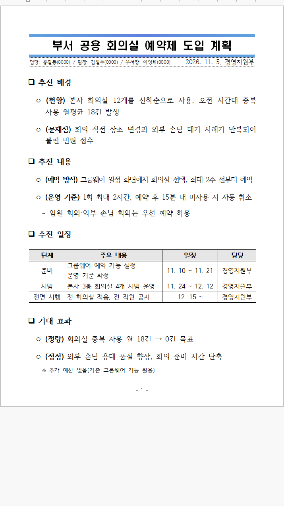 | `plan-report` | 계획보고 | 요약 | 추진 배경 → 추진 내용 → 추진 일정(표) → 기대 효과 |
| 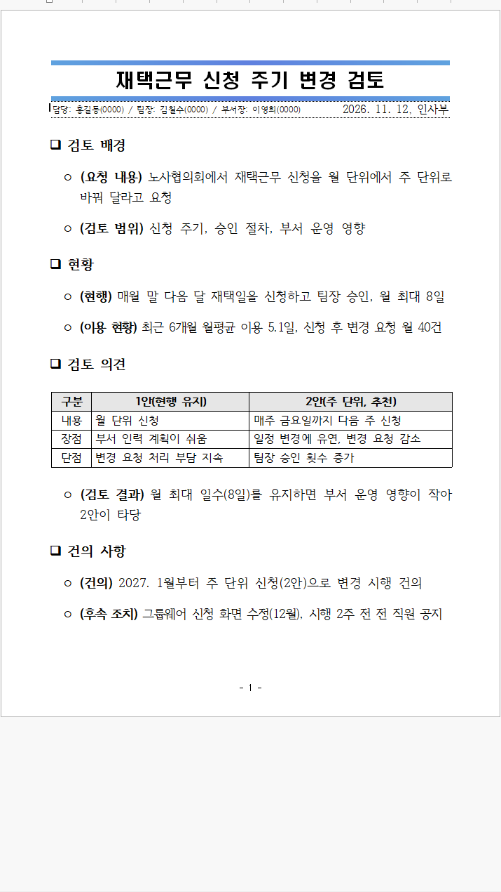 | `review-report` | 검토보고 | 요약 | 검토 배경 → 현황 → 검토 의견(대안 비교표) → 건의 사항 |
| 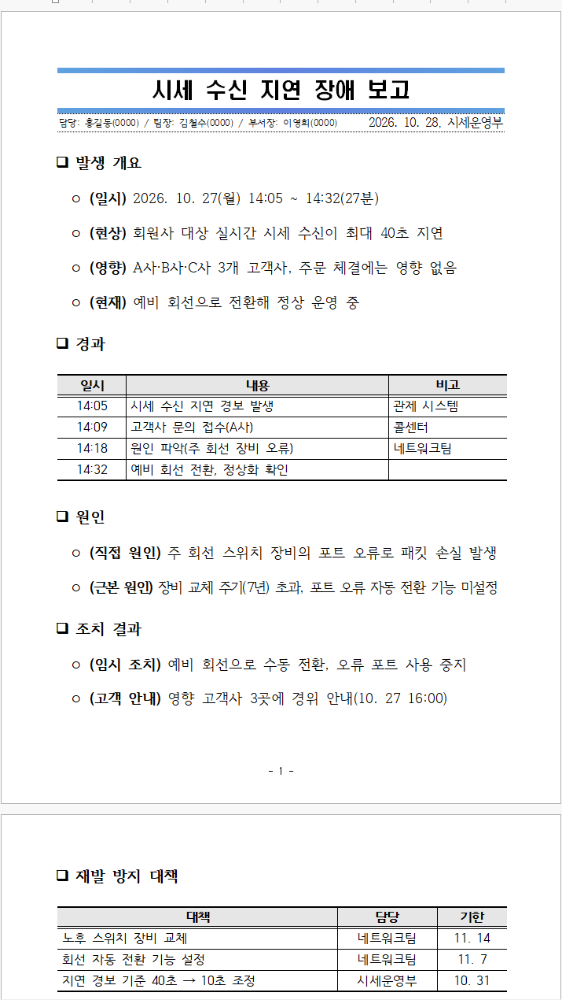 | `issue-report` | 이슈·장애 보고 | 요약 | 발생 개요 → 경과(시각표) → 원인 → 조치 결과 → 재발 방지 대책 |
| 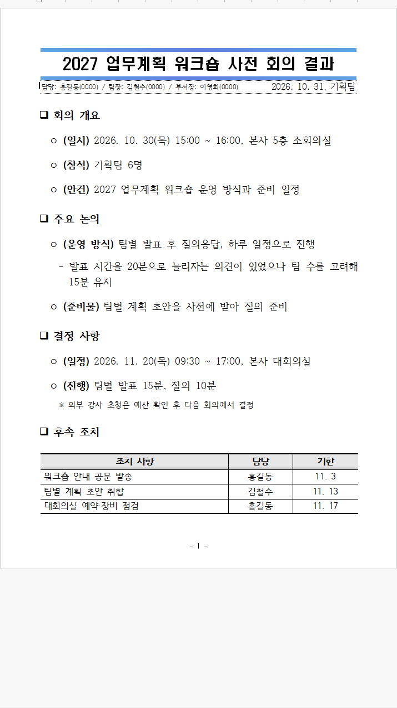 | `meeting-report` | 회의 결과 보고 | 요약 | 회의 개요 → 주요 논의 → 결정 사항 → 후속 조치(표) |
| 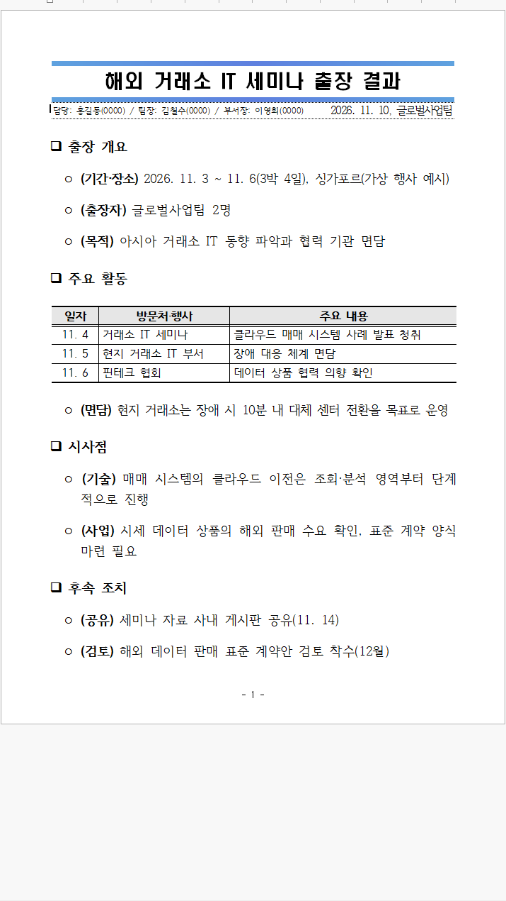 | `trip-report` | 출장 결과 보고 | 요약 | 출장 개요 → 주요 활동(일정표) → 시사점 → 후속 조치 |
| 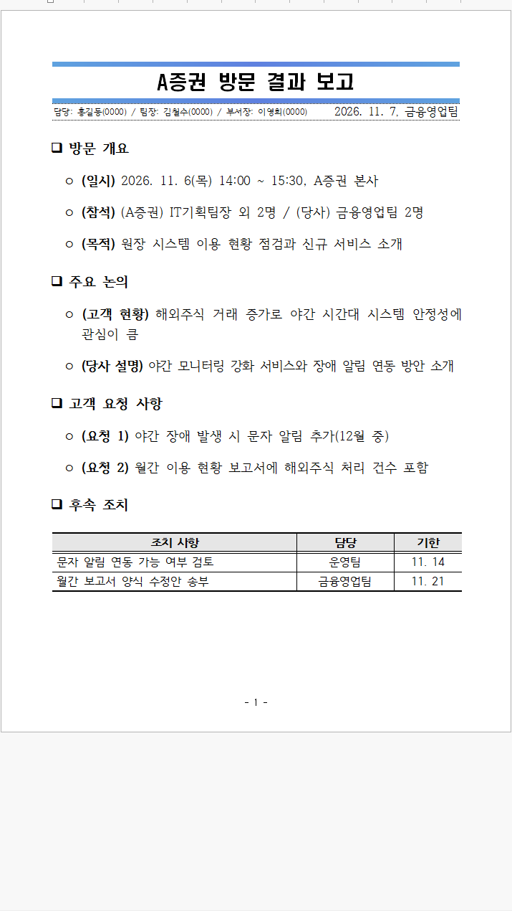 | `visit-report` | 고객 방문 결과 보고 | 요약 | 방문 개요 → 주요 논의 → 고객 요청 사항 → 후속 조치(표) |
| 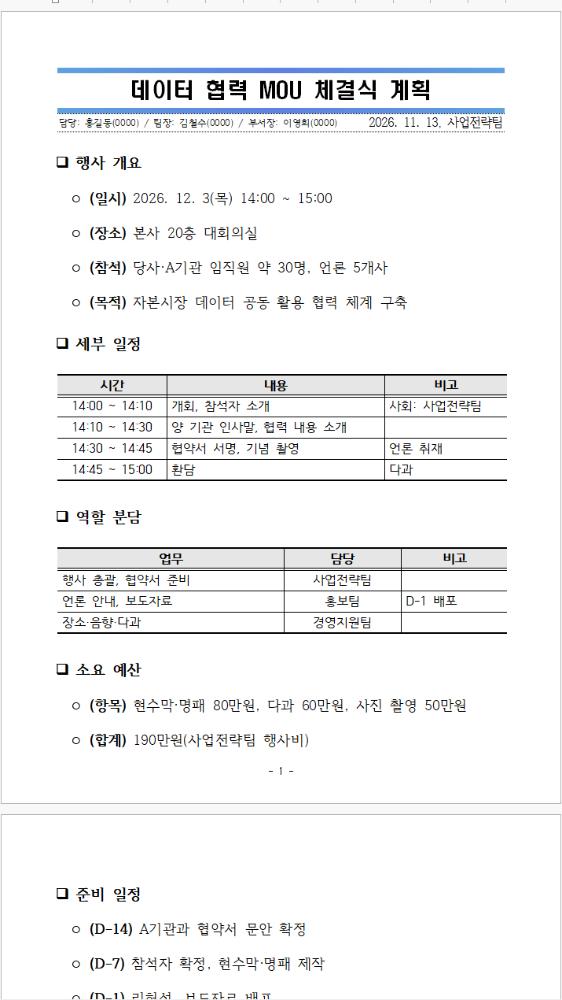 | `event-plan` | 행사 계획 보고 | 요약 | 행사 개요 → 세부 일정(시간표) → 역할 분담(표) → 소요 예산 → 준비 일정 |
| 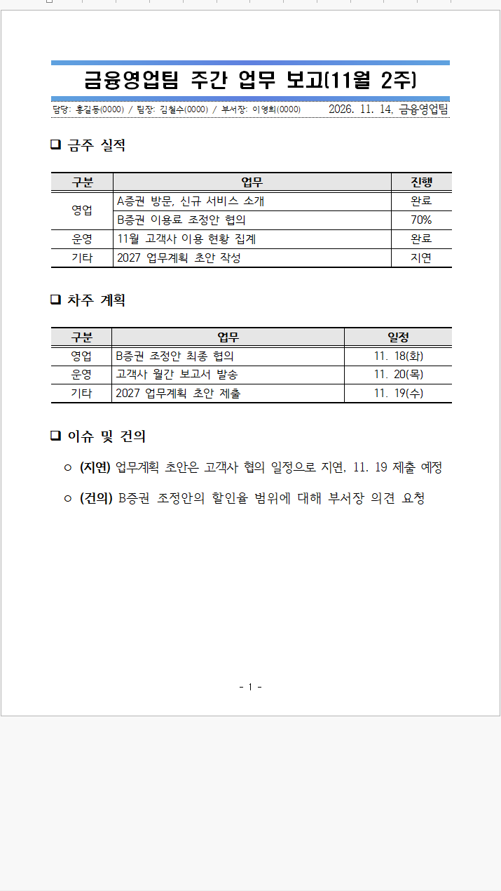 | `weekly-report` | 주간 업무 보고 | 요약 | 금주 실적(표) → 차주 계획(표) → 이슈 및 건의 |
| 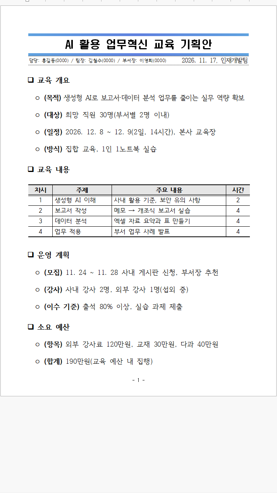 | `education-plan` | 교육 기획안 | 요약 | 교육 개요 → 교육 내용(커리큘럼표) → 운영 계획 → 소요 예산 |
| 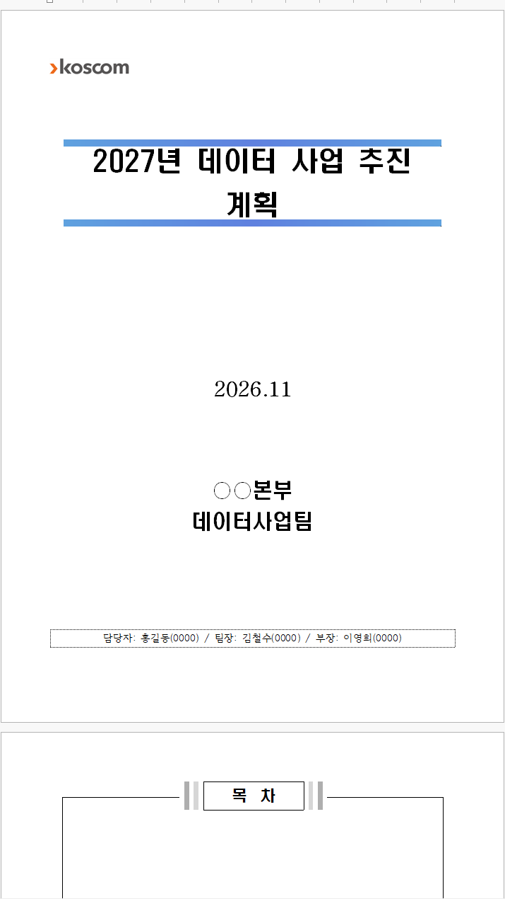 | `business-plan` | 사업계획서·기획서 | 상세 | I.추진 배경 → II.추진 현황 → III.기본 방향 → IV.추진 과제 → V.기대 효과 |
| 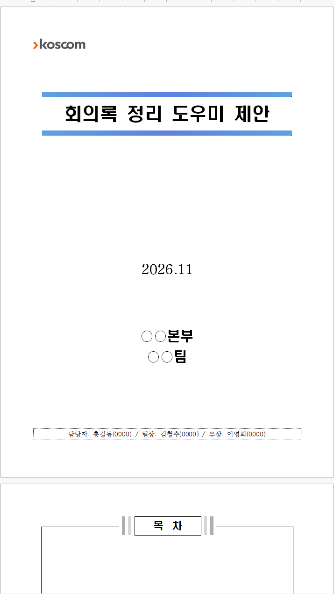 | `proposal` | 제안서·공모전 기획서 | 상세 | I.제안 배경 → II.현황 분석 → III.제안 개요 → IV.추진 내용 → V.추진 계획 → VI.기대 효과 → 별첨 |
| 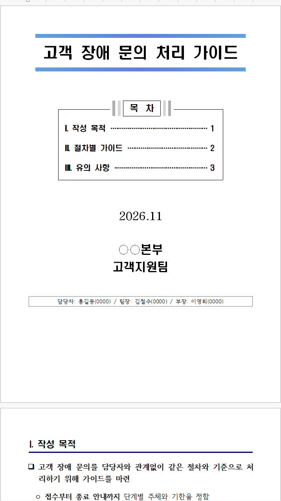 | `guide` | 업무 가이드·매뉴얼 | 상세(간략 표지) | I.작성 목적 → II.절차별 가이드 → III.유의 사항 |

## 폴더 구성

```text
presets/
├── presets_index.json     # 스킬이 읽는 목록(preset.md 앞머리에서 생성, 손으로 고치지 않음)
└── <id>/
    ├── preset.md          # 앞머리(메타데이터) + 구성·표·작성 규칙
    ├── example.json       # 가명 예시 report.json ("preset": "<id>" 포함)
    └── preview.png        # 예시를 한컴 뷰어로 연 첫 화면
```

`preset.md` 앞머리 항목:

| 키 | 뜻 |
|---|---|
| `id` | 폴더 이름과 같아야 한다 |
| `name`, `summary` | 이름과 한 줄 설명. 템플릿을 고를 때 쓴다 |
| `base` | `summary`(요약보고) 또는 `detail`(상세보고) |
| `pages`, `heading_style`, `cover` | 분량, 대제목 모양, 상세보고 표지 종류 |
| `outline` | 대제목(상세보고는 장) 순서. 구성 확인에 쓴다 |
| `table_in` | 표가 꼭 있어야 하는 대제목 |
| `keywords` | 요청에서 이 템플릿을 고를 단서 |

목록 값은 `[a, b]`처럼 한 줄로 쓴다.

## 도구 (`scripts/presets.py`)

```powershell
python scripts\presets.py index            # presets_index.json 다시 만들기
python scripts\presets.py index --check    # 최신인지 확인
python scripts\presets.py check report.json  # report.json이 프리셋 구성을 따르는지
python scripts\presets.py test             # 13종 예시를 모두 렌더링하고 확인(회귀 시험)
```

## 새 템플릿 추가하기

1. `presets/<새 id>/preset.md`를 기존 것을 본떠 쓴다. 구성은 실제로 자주 받는 문서에서 가져온다.
2. `example.json`을 가명·가상 수치로 쓰고 `"preset": "<새 id>"`를 넣는다.
3. `python scripts\presets.py index`로 목록을 다시 만든다.
4. `python scripts\presets.py test --only <새 id> --out <폴더>`로 경고 없이 렌더링되는지 본다.
5. `scripts\preview.ps1`로 열어 확인하고, 첫 화면을 `preview.png`로 저장한다.
6. 이 README 목록과 `SKILL.md` 1-1단계 표에 한 줄 추가한다.

새 템플릿이 요약·상세 양식 모양 자체를 바꿔야 한다면(공문, 계약서 등) 프리셋이 아니라 새 base 템플릿이 필요하다. 그 경우는 원본 빈 서식을 받아 `TemplateBuilder`로 만든다.
